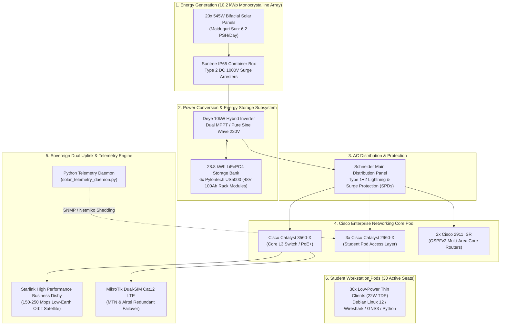

# Solar-Powered Cyber & Cisco Networking Academy — Northeast Nigeria

[](LICENSE)
[](https://opencollective.com/cisco-cyber-academy-nigeria)
[](.github/workflows/lint-and-validate.yml)
[](https://www.netacad.com)
[](automation/)
[](https://opencollective.com/cisco-cyber-academy-nigeria)
[-E65100.svg)](https://maps.google.com/?q=Royas+Plaza+Damboa+Road+Maiduguri+Nigeria)
[](https://opencollective.com/cisco-cyber-academy-nigeria)

---

## 1. Executive Summary & The Mission

In Maiduguri, Borno State, ambitious youth face systemic infrastructural barriers to enterprise technology livelihoods. Foremost among these barriers is **severe municipal grid instability**: regional high-voltage transmission lines experience frequent, prolonged disruptions, frequently leaving the metropolis dependent on unreliable utility power.

```
       ====================================================================
                        MAIDUGURI CRITICAL CONTEXT
       * Municipal Grid Reliability: < 15% annual availability
       * Regional Youth Unemployment: > 60%
       * Female STEM Participation: < 12% in the Lake Chad Basin
       * Solution: Sovereign, Off-Grid Solar-Powered Technical Infrastructure
       ====================================================================
```

Traditional vocational labs in Northeast Nigeria depend on erratic municipal utility lines or prohibitively expensive diesel generators that emit toxic exhaust and shut down during fuel supply shortages.

**ESSCO TECH AGENCY LTD (RC: 7192842)** has broken this cycle by engineering an off-grid, ruggedized, **10.2 kWp Solar Photovoltaic Microgrid** coupled to a **28.8 kWh Lithium Iron Phosphate (LiFePO4) battery storage bank**. This power station energizes a physical Cisco Systems hardware pod and defensive cybersecurity training facility located at **Royas Plaza, Damboa Road, Maiduguri**.

### The Academy Objective
1. **Zero-Tuition Enterprise Education**: Deliver free, elite-tier training in Cisco Enterprise Routing & Switching (CCNA / CCST), Defensive Cybersecurity Operations (SOC Blue Team / Cisco CyberOps), and Python Network Programmability.
2. **Targeted Demographics**: Train 100 ambitious, vulnerable youth per annual cohort, enforcing a **strict 60% female enrollment mandate** to bridge the regional gender equity divide in enterprise technology engineering.
3. **Open Educational Resource (OER)**: Maintain this repository as a globally inspectable, version-controlled open curriculum, complete with physical hardware Bill of Materials (BOM), automated load-shedding telemetry code, and production network configuration templates.

---

## 2. Infrastructure Architecture & Power Topology

The facility is engineered to operate 100% off-grid with zero diesel generator dependence. Power generation, storage, and networking are unified into an autonomous feedback loop:



### ASCII Microgrid Single-Line Diagram
```
 [ 20x 545W PV Array: 10.9 kWp ]
                 | (DC 380V String)
                 v
   +-----------------------------+
   | Suntree DC Combiner + SPDs  |
   +-----------------------------+
                 |
                 v
   +-----------------------------+        +------------------------------+
   | Deye 10kW Hybrid Inverter   | <====> | 48V 28.8 kWh LiFePO4 Bank    |
   +-----------------------------+ (48V)  | 6x 100Ah Pylontech Modules   |
                 | (220V AC, 50Hz)        +------------------------------+
                 v
   +-----------------------------+
   | Schneider MDB + Type 1+2 SPD|
   +-----------------------------+
                 |
       +---------+-------------------+--------------------+
       |                             |                    |
       v                             v                    v
+--------------+              +---------------+    +-------------------+
| Cisco 3560X  |              | Cisco 2911    |    | 30x Thin Clients  |
| Core Switch  |              | Gateway Router|    | Debian Linux 12   |
+--------------+              +---------------+    +-------------------+
       |                             |
       v                             v
[ Starlink Dishy ]            [ MikroTik LTE ]
```

---

## 3. Autonomous Microgrid Load-Shedding State Machine

During extreme environmental events—such as thick dry-season Harmattan dust storms obscuring the sun for multiple days—the facility's autonomous telemetry daemon (`automation/solar_telemetry_daemon.py`) enforces a **3-Tier Dynamic Load Shedding Strategy** to protect core communications:

```
                      +-----------------------------+
                      |   STATE 1: NORMAL POWER     |
                      |   Battery SoC > 50%         |
                      |   All 30 Stations Active    |
                      +-----------------------------+
                                     │
           Battery drops < 50%       │       Battery recovers > 55%
                                     ▼       (Hysteresis Loop)
                      +-----------------------------+
                      |   STATE 2: CONSERVE POWER   |
                      |   25% <= Battery SoC <= 50% |
                      |   Secondary Ports Shed      |
                      +-----------------------------+
                                     │
           Battery drops < 25%       │       Battery recovers > 30%
                                     ▼       (Hysteresis Loop)
                      +-----------------------------+
                      |  STATE 3: CRITICAL SURVIVAL |
                      |  Battery SoC < 25%          |
                      |  Only Core Gateway Powered  |
                      +-----------------------------+
```

1. **Stage 1 (NORMAL - SoC > 50%)**: Full classroom capacity. All 30 student workstations, auxiliary overhead instructional projectors, access points, and hardware switch stacks are energized.
2. **Stage 2 (CONSERVE - 25% to 50% SoC)**: The daemon automatically logs into access switches via Netmiko and disables secondary auxiliary switchports (`GigabitEthernet0/13 - 24`), shutting off dual-monitor displays and secondary test pods while keeping primary terminals operational.
3. **Stage 3 (CRITICAL SURVIVAL - SoC < 25%)**: All student access ports are shut down. Power is routed exclusively to the Core Cisco 2911 Router, the Starlink transceiver, the emergency IoT telemetry node, and one instructor diagnostic terminal. This state maintains satellite telemetry and communications for **up to 102 continuous hours (4.25 days)** without any sunlight.

---

## 4. Repository Structure & Artifact Guide

```
solar-cisco-networking-academy/
├── .github/
│   ├── FUNDING.yml                  # Open Collective & GitHub Sponsors configuration
│   └── workflows/
│       └── lint-and-validate.yml    # CI: Lints Python, validates Snort rules & Cisco IOS
├── LICENSE                          # MIT License granted to ESSCO TECH AGENCY LTD
├── README.md                        # Master architectural blueprint, mission, and tiers
├── CODE_OF_CONDUCT.md               # Contributor Covenant v2.1 with regional protections
├── CONTRIBUTING.md                  # Rigorous engineering standards & pull request guide
├── SECURITY.md                      # Vulnerability disclosure SLA & threat model
├── curriculum/
│   ├── 01-networking-fundamentals.md# IPv4/IPv6 VLSM, 802.1Q, Rapid-PVST, OSPFv2 mechanics
│   ├── 02-defensive-cybersecurity.md # CIS Linux hardening, Wireshark forensics, Snort NIDS
│   └── 03-python-network-automation.md # Netmiko orchestration, RESTCONF, and config drift
├── labs/
│   ├── lab-01-cisco-ios-hardening.ios # Production Cisco IOS switch/router security baseline
│   ├── lab-02-ospfv2-multi-area-topology.ios # Authenticated multi-area OSPF routing template
│   └── lab-03-snort-threat-detection.rules # 10 production IDS rules for enterprise defense
├── automation/
│   ├── requirements.txt             # Pinned dependencies (netmiko, rich, pydantic, pysnmp)
│   ├── cisco_backup_engine.py       # Multi-threaded config backup & drift detection tool
│   └── solar_telemetry_daemon.py    # Autonomous solar telemetry & load-shedding engine
└── hardware/
    └── BOM.md                       # Comprehensive Bill of Materials, power models & costs
```

---

## 5. Transparent Open Collective Sponsorship Tiers

We operate under **radical fiscal transparency**. All donations are disbursed through the **Open Source Collective (501(c)(6))**, where every dollar, invoice, and equipment purchase order is publicly visible on our ledger.

👉 **Donate Directly on Open Collective**: [https://opencollective.com/cisco-cyber-academy-nigeria](https://opencollective.com/cisco-cyber-academy-nigeria)

```
+---------------------------------------------------------------------------------------+
|                              SPONSORSHIP IMPACT TIERS                                 |
+---------+--------------------+--------------------------------------------------------+
| Amount  | Tier Name          | Concrete Engineering & Open Educational Deliverable    |
+---------+--------------------+--------------------------------------------------------+
| $50     | Gateway Seat       | Funds 1 student's monthly share of high-speed          |
|         |                    | Starlink satellite bandwidth, lab power, and terminal. |
+---------+--------------------+--------------------------------------------------------+
| $150    | Hardware Toolset   | Equips 1 student with physical network tooling:        |
|         |                    | FTDI console cable, Cat6 crimper, punch-down tool,     |
|         |                    | digital multimeter, and ESP32 telemetry sensor kit.    |
+---------+--------------------+--------------------------------------------------------+
| $350    | Certification Exam | Fully underwrites 1 official industry exam voucher     |
|         | Voucher            | for Cisco Certified Support Technician (CCST) or       |
|         |                    | Cisco CyberOps Associate for a qualified student.      |
+---------+--------------------+--------------------------------------------------------+
| $1,000  | Institutional Pod  | Sponsors a dedicated 6-workstation Cisco Catalyst      |
|         | Sponsor            | hardware pod, including an individual LiFePO4 battery  |
|         |                    | cell reserve, providing sovereign power for a cohort.  |
+---------+--------------------+--------------------------------------------------------+
```

---

## 6. Institutional Verification, Governance & Auditing

The Academy is operated under strict corporate governance and educational credentials:

| Governance Attribute | Official Verification Record |
| :--- | :--- |
| **Operating Entity** | **ESSCO TECH AGENCY LTD** |
| **Corporate Registration** | Registered with the Corporate Affairs Commission (CAC), Federal Republic of Nigeria — **RC: 7192842** |
| **Tax Identification Number** | Verified and active in the Federal Inland Revenue Service (FIRS) database |
| **Physical Campus** | Royas Plaza, Damboa Road, Maiduguri, Borno State, Northeast Nigeria (Postal Code: `600282`) |
| **Educational Partnership** | Approved **Cisco Networking Academy Partner** |
| **Fiscal Host & Non-Profit Status** | Hosted by **Open Source Collective 501(c)(6)** |
| **Open Collective URL** | [`opencollective.com/cisco-cyber-academy-nigeria`](https://opencollective.com/cisco-cyber-academy-nigeria) |
| **Executive Governance Contact** | `governance@esscotechagency.com` |
| **Security Operations Contact** | `security@esscotechagency.com` |

---

## 7. Quickstart: Running Academy Tools Locally

### 1. Clone & Set Up
```bash
git clone https://github.com/esscotech-academy/solar-cisco-networking-academy.git
cd solar-cisco-networking-academy

python -m venv .venv
source .venv/bin/activate  # On Windows: .venv\Scripts\Activate.ps1
pip install -r automation/requirements.txt
```

### 2. Test Multi-Threaded Cisco Backup Engine (Mock Mode)
```bash
python automation/cisco_backup_engine.py --dry-run --mock
```

### 3. Run Autonomous Solar Telemetry & Load-Shedding Daemon
```bash
python automation/solar_telemetry_daemon.py --mock --iterations 3 --interval 1
```

---

## 8. License

This repository and all associated curriculum modules, hardware schematics, and automation tools are released under the [MIT License](LICENSE).

Copyright (c) 2026 ESSCO TECH AGENCY LTD (RC: 7192842) and contributors.
